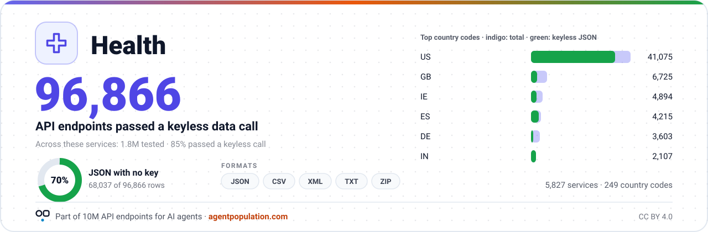
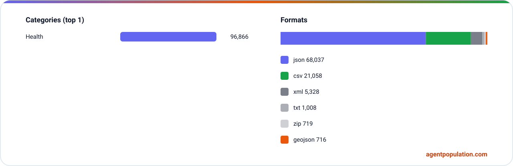

<p align="center"></p>

# 🏥 Health API endpoints

**96,866 health API endpoints that answered a keyless GET with a data body. For agent and app builders.**

<p align="center"><a href="#files"></a> <a href="#columns-and-tags"></a> <a href="#whats-inside"></a> <a href="#whats-inside"></a> <a href="LICENSE"></a></p>

<p align="center"><a href="#whats-in-it-for-you">What's in it</a> · <a href="#for-ai-agents">For AI agents</a> · <a href="#quick-start">Quick start</a> · <a href="#test-it-yourself">Test it yourself</a> · <a href="#files">Files</a> · <a href="#licence-and-credit">Licence</a> · <a href="#part-of-10m-api-endpoints-for-ai-agents">More packs</a></p>

This repository holds a 1,000-row sample and the services list; the full list of 96,866 endpoints is one download from the [latest release](https://github.com/agentpopulation/96k-health-apis-for-agents/releases/latest).

**Endpoints for building a health, hospital or disease lookup.** WHO and UNICEF health indicators by country, hospital, clinic and health-facility map layers, disease, mortality and COVID-19 tables from national and regional portals, as URLs that answered with no key on their test date.

Selection rule: rows where `category is "Health"`, less the rows that a leave-out rule drops (each counted under Known limits).

64,303 of these 96,866 rows match the focus rule (below); the others are in the pack by the selection rule only, and Known limits says what they are. 32,200 rows (33.2%) are map layers on ArcGIS Online, where anyone can publish.

## In plain words

**What is an API endpoint?** An API endpoint is one web address that a program can ask for data, for example the latest reading at one weather station. A single service, such as a national weather agency, can have thousands of endpoints: one per station, city or dataset. This pack counts endpoints, not separate services.

**What does "passed a data call" mean?** On the date shown in each row, AgentPopulation sent one plain request to that address, with no password or key, and got a non-empty data body back (JSON, CSV, XML or a file): not an error page and not an empty result. Some bodies describe a dataset rather than hold its values; see Known limits. It shows the address answered with data on that day. It is not a promise that it answers today, and licences and usage limits were not reviewed.

## What's in it for you

Four ways to use this pack. Each bucket gives a count, a filter you can apply to the CSV, one example that passed, and a list of recommended starting points with the rule that picked them. Buckets overlap; a row can fit more than one.

Examples, recommended lists and the preview are drawn from rows that match this pack's focus rule, so a row that the selection rule put in this pack but that is about something else is not shown as a starting point. Counts cover the whole bucket.

<details>
<summary>The focus rule</summary>

Focus rule: `(title matches /health|hospital|clinic|covid|corona|sars-cov|disease|mortality|deaths?\b|vaccin|immuni[sz]|patient|medic|pharma|nurs(e|ing)|doctor|physician|cancer|diabet|obes|asthma|matern|infant|neonat|births?\b|life expectancy|\bhiv\b|malaria|tubercul|influenza|sick|illness|dental|mental|suicide|overdose|opioid|alcohol|tobacco|smok|nutrition|an(a)?emia|stunting|epidem|outbreak|santé|sante\b|sanità|sanitar|gesundheit|krankenh|klinik|salud|saúde|zdrav|ambulanc|care home|hospice|injur|cardio|heart|stroke|hypertens|cholera|measles|dengue|pandem|infect|fertility|pregnan|breastfeed|morbid|apothek|ärzt|arzt|sterbe|gestorb|décès|mortalit|lékař|nemoc|sjuk|helse|terveys/i OR subcategory matches /WHO Global Health Observatory|UNICEF child|OWID chart|Humanitarian Data Exchange · health/i) AND NOT (title matches /covid|corona(?!ry)|sars-cov/i AND title matches /turnover|enterprise|innovation|remote work|financ|employ|business|recruitment|grants?\b|resoluciones|precio|prices?\b|mercamadrid|income support|benefits|\baide\b|ayuda|hilfe|soutien|\bfonds\b|subvention/i) AND NOT url matches /sdmx\.data\.unicef\.org/.*/[A-Z]{3}\.(DM_|PT_)/i AND NOT title matches /market share|government finance|revenue breakdown/i`

</details>

### 🤖 Agent tools: Health indicators and facility layers an agent can query

**46,240** endpoints from 4,255 services · Wrap the WHO indicator query as a get_health_indicator tool: pass an indicator code and a country code, return the values by year (and by sex where the indicator has it) with a timeout.

3,061 of these are WHO Global Health Observatory queries for one indicator and one country; change the indicator code or the country code in the URL for others.

22,679 of these are map-layer queries that asked for a few records (`resultRecordCount`); raise it or page through for the whole layer.

Start with: `tags has agent-ready AND (title matches /health|hospital|clinic|covid|corona|sars-cov|disease|mortality|deaths?\b|vaccin|immuni[sz]|patient|medic|pharma|nurs(e|ing)|doctor|physician|cancer|diabet|obes|asthma|matern|infant|neonat|births?\b|life expectancy|\bhiv\b|malaria|tubercul|influenza|sick|illness|dental|mental|suicide|overdose|opioid|alcohol|tobacco|smok|nutrition|an(a)?emia|stunting|epidem|outbreak|santé|sante\b|sanità|sanitar|gesundheit|krankenh|klinik|salud|saúde|zdrav|ambulanc|care home|hospice|injur|cardio|heart|stroke|hypertens|cholera|measles|dengue|pandem|infect|fertility|pregnan|breastfeed|morbid|apothek|ärzt|arzt|sterbe|gestorb|décès|mortalit|lékař|nemoc|sjuk|helse|terveys/i OR subcategory matches /WHO Global Health Observatory|UNICEF child|OWID chart|Humanitarian Data Exchange · health/i)`

Example: [WHO GHO: Life expectancy at birth (years) - Afgha…](https://ghoapi.azureedge.net/api/WHOSIS_000001?$filter=SpatialDim%20eq%20%27AFG%27) · Azureedge · passed 2026-11-14

<details>
<summary>Recommended starting points: 8 services, picked by the stated criteria inside</summary>

**Recommended starting points.** Selected by stated criteria, not a ranking of quality: Services in this pack with the most endpoints that match this bucket and are tagged `agent-ready` (no key sent in the test call, JSON body, passed a data call). Ties go to the service with more country codes, then by name. Only services with at least one bucket row that matches the focus rule are listed, and the sample comes from those rows; the counts cover the whole bucket. The sample URL is the first row by URL sort after preferring, in this order: rows that match the bucket's sample preference when it has one, rows that return values rather than describe a dataset or a service (not ERDDAP /info/ pages, OGC GetCapabilities requests, bare OWS addresses, PxWeb tables, UN SDG series lists, Statistics Canada download pointers, WorldPop listings, GTFS validation reports, untitled rows or service root addresses), and agent-ready rows. Sample preference in this bucket: `url contains "ghoapi.azureedge.net/api/WHOSIS_"`. Services named "ArcGIS organization" hold map layers from many owners and are added only when fewer than 5 other services match.

| Service (host) | Endpoints in bucket | In pack | Country codes in bucket | Formats in bucket | Sample URL that passed |
|---|---:|---:|---|---|---|
| Azureedge (ghoapi.azureedge.net) | 3,061 | 3,061 | 172 codes | json | [WHO GHO: Life expectancy at birth (year…](https://ghoapi.azureedge.net/api/WHOSIS_000001?$filter=SpatialDim%20eq%20%27AFG%27) (2026-11-14) |
| Nih (api-evsrest.nci.nih.gov) | 1,000 | 1,000 | US | json | [National Cancer Institute (Enterprise V…](https://api-evsrest.nci.nih.gov/api/v1/concept/ncit/C100436) (2026-11-15) |
| Nih (clinicaltables.nlm.nih.gov) | 1,000 | 1,000 | US | json | [U.S. National Library of Medicine (List…](https://clinicaltables.nlm.nih.gov/api/conditions/v3/search?terms=absint&maxList=20) (2026-11-15) |
| Nih (rxnav.nlm.nih.gov) | 1,000 | 1,000 | US | json | [U.S. National Library of Medicine: RxNa…](https://rxnav.nlm.nih.gov/REST/rxcui/1009346/historystatus.json) (2026-11-15) |
| Saude (apidadosabertos.saude.gov.br) | 969 | 969 | BR | json | [Ministério da Saúde (Brazil) API Dados …](https://apidadosabertos.saude.gov.br/cnes/estabelecimentos?codigo_municipio=110001&limit=20) (2026-11-15) |
| University of South Florida GIS (ArcGIS Online) (services1.arcgis.com) | 792 | 799 | US | json | [10 mile Buffer around clinics](https://services1.arcgis.com/sQOueNHZBxRJjRN3/arcgis/rest/services/10%20mile%20Buffer%20around%20clinics/FeatureServer/0/query?where=1%3D1&outFields=*&returnGeometry=false&resultRecordCount=5&f=json) (2026-11-14) |
| CDC (data.cdc.gov) | 748 | 1,544 | US | json | [HealthData.Gov: ckan\_resource\_json](https://data.cdc.gov/api/v3/views/23gt-ssfe/query.json?accessType=DOWNLOAD) (2026-11-15) |
| Statistics Norway PxWeb (data.ssb.no) | 731 | 1,129 | NO | json | [Norway statistics: 13493: Persons aged …](https://data.ssb.no/api/v0/en/table/al/al03/aku/SBMENU9720/SBMENU10654/Akutu14) (2026-11-15) |

</details>

### 📱 App features: Hospitals, clinics, pharmacies and health facilities for maps and finders

**6,143** endpoints from 1,688 services · Build a find_nearest_hospital card: load facility layers for one area, return name, type and address for the nearest few, and show them on a map.

Start with: `(tags has maps OR format is geojson OR subcategory matches /Humanitarian Data Exchange · health|WFS|WMS|GEOJSON|KML/i) AND title matches /hospitals?\b|clinics?\b|pharmac|health (facilit|cent|post|site)|medical (cent|facilit)|doctors?\b|urgent care|ambulanc|nursing homes?|care homes?|krankenh|apothek|ospedal|farmac|hôpita|centres? de santé|gp surger|dentist/i`

Example: [XPlanung dataset BPL ‘Auerbachstraße (Robert Bosc…](https://geodienste.komm.one/ows/services/org.152.b5d3e01f-2ed2-4ee4-b33f-7b80993045a0_wfs/org.152.71880ea6-9b45-487d-b4e9-807bda5e2244?SERVICE=WFS&Request=GetCapabilities) · Komm · passed 2026-11-14

<details>
<summary>Recommended starting points: 8 services, picked by the stated criteria inside</summary>

**Recommended starting points.** Selected by stated criteria, not a ranking of quality: Services in this pack with the most endpoints that match this bucket and passed a data call. Ties go to the service with more country codes, then by name. Only services with at least one bucket row that matches the focus rule are listed, and the sample comes from those rows; the counts cover the whole bucket. The sample URL is the first row by URL sort after preferring, in this order: rows that match the bucket's sample preference when it has one, rows that return values rather than describe a dataset or a service (not ERDDAP /info/ pages, OGC GetCapabilities requests, bare OWS addresses, PxWeb tables, UN SDG series lists, Statistics Canada download pointers, WorldPop listings, GTFS validation reports, untitled rows or service root addresses), and agent-ready rows. Sample preference in this bucket: `title matches /hospitals?\b|clinics?\b|pharmac|health (facilit|cent|post|site)|medical (cent|facilit)|doctors?\b|urgent care|ambulanc|nursing homes?|care homes?|krankenh|apothek|ospedal|farmac|hôpita|centres? de santé|gp surger|dentist/i AND NOT url matches ///(services[0-9]*(-[a-z0-9]+)?|utility)\.arcgis\.com//i AND NOT format is zip`. Services named "ArcGIS organization" hold map layers from many owners and are added only when fewer than 5 other services match.

| Service (host) | Endpoints in bucket | In pack | Country codes in bucket | Formats in bucket | Sample URL that passed |
|---|---:|---:|---|---|---|
| S3 (AWS) (production-raw-data-api.s3.amazonaws.com) | 184 | 436 | 184 codes | zip | [HDX: Health Facilities of Aruba](https://production-raw-data-api.s3.amazonaws.com/ISO3/ABW/health_facilities/hotosm_abw_health_facilities_osm_geojson.zip) (2026-11-14) |
| University of Texas at Arlington (ArcGIS Online) (services5.arcgis.com) | 178 | 211 | GB, US | json | [0 Min Drive to Hospital GW1](https://services5.arcgis.com/z5pCt1Uf7GwSRRTu/arcgis/rest/services/0%20Min%20Drive%20to%20Hospital%20GW1/FeatureServer/0/query?where=1%3D1&outFields=*&returnGeometry=false&resultRecordCount=5&f=json) (2026-11-14) |
| Harrisburg Area Community College (ArcGIS Online) (services1.arcgis.com) | 83 | 100 | US | json | [20 Min Drive to Hospital AI](https://services1.arcgis.com/IqEe3YDHhqT8n4KU/arcgis/rest/services/20%20Min%20Drive%20to%20Hospital%20AI/FeatureServer/0/query?where=1%3D1&outFields=*&returnGeometry=false&resultRecordCount=5&f=json) (2026-11-15) |
| UAB Campus GIS License (ArcGIS Online) (services9.arcgis.com) | 81 | 197 | IN, US | json | [ArcGIS Online org TF8guKGduTImPkWg: Pha…](https://services9.arcgis.com/TF8guKGduTImPkWg/ArcGIS/rest/services/PharmacyDrugStores_AAG/FeatureServer/0/query?where=1%3D1&outFields=*&resultRecordCount=10&f=json) (2026-11-15) |
| Africa GeoPortal (ArcGIS Online) (services8.arcgis.com) | 72 | 196 | 4 codes | json | [A 15min de Nkombo Hospital](https://services8.arcgis.com/oTalEaSXAuyNT7xf/arcgis/rest/services/A%2015min%20de%20Nkombo%20Hospital/FeatureServer/0/query?where=1%3D1&outFields=*&returnGeometry=false&resultRecordCount=5&f=json) (2026-11-15) |
| Farmingdale State College (ArcGIS Online) (services7.arcgis.com) | 59 | 407 | US | json | [20 Min Drive to Hospital Evan K](https://services7.arcgis.com/6o0M9YyJcHjZF5MP/arcgis/rest/services/20%20Min%20Drive%20to%20Hospital%20Evan%20K/FeatureServer/0/query?where=1%3D1&outFields=*&returnGeometry=false&resultRecordCount=5&f=json) (2026-11-14) |
| Indiana University (ArcGIS Online) (services.arcgis.com) | 49 | 118 | US | json | [0 Min Drive to Hospital MK](https://services.arcgis.com/tKsJAIiLjd90D5q2/arcgis/rest/services/0%20Min%20Drive%20to%20Hospital%20MK/FeatureServer/0/query?where=1%3D1&outFields=*&returnGeometry=false&resultRecordCount=5&f=json) (2026-11-14) |
| Tampa General Hospital (ArcGIS Online) (services8.arcgis.com) | 47 | 59 | US | json | [10 Mile Distance around TGH Hospitals](https://services8.arcgis.com/cbhWiLbsJqlGvOoP/arcgis/rest/services/10%20Mile%20Distance%20around%20TGH%20Hospitals/FeatureServer/0/query?where=1%3D1&outFields=*&returnGeometry=false&resultRecordCount=5&f=json) (2026-11-14) |

</details>

### 🧠 Grounding and data pipelines: Indicator series and health statistics tables for scheduled loads

**34,865** endpoints from 796 services · Load mortality, vaccination and life-expectancy series on a schedule into your own store, so answers about a country's health cite a dated source.

Start with: `subcategory matches /WHO Global Health|UNICEF|OWID|Eurostat|StatCan|PxWeb|WB indicator/i OR format in (csv, xml, zip, txt)`

Example: [WHO GHO: Life expectancy at birth (years) - Afgha…](https://ghoapi.azureedge.net/api/WHOSIS_000001?$filter=SpatialDim%20eq%20%27AFG%27) · Azureedge · passed 2026-11-14

<details>
<summary>Recommended starting points: 8 services, picked by the stated criteria inside</summary>

**Recommended starting points.** Selected by stated criteria, not a ranking of quality: Services in this pack with the most endpoints that match this bucket and passed a data call. Ties go to the service with more country codes, then by name. Only services with at least one bucket row that matches the focus rule are listed, and the sample comes from those rows; the counts cover the whole bucket. The sample URL is the first row by URL sort after preferring, in this order: rows that match the bucket's sample preference when it has one, rows that return values rather than describe a dataset or a service (not ERDDAP /info/ pages, OGC GetCapabilities requests, bare OWS addresses, PxWeb tables, UN SDG series lists, Statistics Canada download pointers, WorldPop listings, GTFS validation reports, untitled rows or service root addresses), and agent-ready rows. Sample preference in this bucket: `subcategory matches /OWID chart|UNICEF child|Eurostat/i OR url contains "ghoapi.azureedge.net/api/WHOSIS_"`. Services named "ArcGIS organization" hold map layers from many owners and are added only when fewer than 5 other services match.

| Service (host) | Endpoints in bucket | In pack | Country codes in bucket | Formats in bucket | Sample URL that passed |
|---|---:|---:|---|---|---|
| Azureedge (ghoapi.azureedge.net) | 3,061 | 3,061 | 172 codes | json | [WHO GHO: Life expectancy at birth (year…](https://ghoapi.azureedge.net/api/WHOSIS_000001?$filter=SpatialDim%20eq%20%27AFG%27) (2026-11-14) |
| Unicef (sdmx.data.unicef.org) | 2,951 | 2,951 | 175 codes | csv, xml | [UNICEF CME\_MRM0: Afghanistan](https://sdmx.data.unicef.org/ws/public/sdmxapi/rest/data/UNICEF,GLOBAL_DATAFLOW,1.0/AFG.CME_MRM0.?format=csv&lastNObservations=10) (2026-11-14) |
| opendata.schleswig-holstein.de | 1,548 | 2,074 | DE | csv | [reported coronavirus cases - data on ag…](https://opendata.schleswig-holstein.de/data/covid-19/cvd_sh_alter_2020-12-17_201841.csv) (2026-11-14) |
| Eurostat dissemination API (ec.europa.eu) | 1,333 | 1,333 | EU | txt, csv, json | [Eurostat: Excess mortality by month](https://ec.europa.eu/eurostat/api/dissemination/statistics/1.0/data/demo_mexrt?lang=en&lastTimePeriod=1) (2026-11-14) |
| Ireland Open Data Portal (ws.cso.ie) | 1,279 | 2,365 | IE | csv | [ASD03 - Alcohol use and drinking patter…](https://ws.cso.ie/public/api.restful/PxStat.Data.Cube_API.ReadDataset/ASD03/CSV/1.0/en) (2026-11-14) |
| Statistics Norway PxWeb (data.ssb.no) | 1,129 | 1,129 | NO | json | [Norway statistics: 13493: Persons aged …](https://data.ssb.no/api/v0/en/table/al/al03/aku/SBMENU9720/SBMENU10654/Akutu14) (2026-11-15) |
| Nih (id.nlm.nih.gov) | 1,000 | 1,000 | US | xml | [U.S. National Library of Medicine: MeSH…](https://id.nlm.nih.gov/mesh/D000067956.json) (2026-11-15) |
| Cancer (api.gdc.cancer.gov) | 998 | 998 | US | csv | [National Cancer Institute Genomic Data …](https://api.gdc.cancer.gov/cases/001f43ba-72d3-40e7-99bd-8aaafb585227) (2026-11-15) |

</details>

### 🧪 Evals and testing: Indicator queries, facility layers and tables to test a health tool

**96,866** endpoints · 5,827 services · 249 country codes · 6 formats · Run your health tool against a fixed set of URLs across formats; check that indicator values, years and facility names parse, and keep last_tested as the baseline for your own re-tests.

Start with: the whole pack

Example: [WHO GHO: Ambient air pollution attributable death…](https://ghoapi.azureedge.net/api/AIR_42?$filter=SpatialDim%20eq%20%27AFG%27) · Azureedge · passed 2026-11-14

<details>
<summary>Recommended starting points: 8 services, picked by the stated criteria inside</summary>

**Recommended starting points.** Selected by stated criteria, not a ranking of quality: Services in this pack that returned the most different formats, then the most endpoints that passed a data call, then by name: a mix of response shapes to test parsers and tool calls. Only services with at least one bucket row that matches the focus rule are listed, and the sample comes from those rows; the counts cover the whole bucket. The sample URL is the first row by URL sort after preferring, in this order: rows that match the bucket's sample preference when it has one, rows that return values rather than describe a dataset or a service (not ERDDAP /info/ pages, OGC GetCapabilities requests, bare OWS addresses, PxWeb tables, UN SDG series lists, Statistics Canada download pointers, WorldPop listings, GTFS validation reports, untitled rows or service root addresses), and agent-ready rows. Services named "ArcGIS organization" hold map layers from many owners and are added only when fewer than 5 other services match.

| Service (host) | Endpoints in bucket | In pack | Country codes in bucket | Formats in bucket | Sample URL that passed |
|---|---:|---:|---|---|---|
| Puglia (dati.puglia.it) | 323 | 323 | IT | csv, json, xml, geojson, txt, zip | [Elenco segnalazioni tecnologie sanitari…](https://dati.puglia.it/ckan/dataset/081c1c88-cf69-44ab-964e-69e75b14dd5d/resource/9b0b5ca8-8e45-4c90-a2a6-c11c5af70adc/download/hta_tecnologie-crehta-prioritarizzate-in-cdr_2023.csv) (2026-11-14) |
| ArcGIS Online: Non (open-geography-portalx-ons.hub.arcgis.com) | 921 | 921 | GB | csv, json, zip, geojson, xml | [Strategic Clinical Networks (December 2…](https://open-geography-portalx-ons.hub.arcgis.com/api/download/v1/items/01bd24b82c154ba48c7b312fc8803c4a/geojson?layers=0) (2026-11-15) |
| Портал відкритих даних (data.gov.ua) | 391 | 391 | UA | csv, xml, json, txt, zip | [Інтегральні показники закладів охорони …](https://data.gov.ua/dataset/4248dac0-edd2-4705-a279-aad7c9710130/resource/33586282-9567-4721-b510-cdc223331a01/download/indicatorhealth_ifoda.json) (2026-11-15) |
| NYC Open Data (Socrata) (data.cityofnewyork.us) | 215 | 215 | US | json, xml, csv, txt, zip | [Pregnancy-Associated Mortality - JSON F…](https://data.cityofnewyork.us/api/views/27x4-cbi6/rows.json?accessType=DOWNLOAD) (2026-11-15) |
| Napsgfoundation (prep-response-portal.napsgfoundation.org) | 55 | 55 | global or unknown | csv, xml, json, geojson, zip | [Deaths - GeoJSON](https://prep-response-portal.napsgfoundation.org/api/download/v1/items/1cb306b5331945548745a5ccd290188e/geojson?layers=0) (2026-11-15) |
| Esri (coronavirus-resources.esri.com) | 47 | 47 | global or unknown | json, csv, xml, zip, geojson | [Deaths - GeoJSON](https://coronavirus-resources.esri.com/api/download/v1/items/1cb306b5331945548745a5ccd290188e/geojson?layers=0) (2026-11-15) |
| opendata.dc.gov | 33 | 33 | US | csv, xml, geojson, json, zip | [DC Health Planning Neighborhoods to Cen…](https://opendata.dc.gov/api/download/v1/items/20c55739045b4fe7b7b7ade69456c109/csv?layers=14) (2026-11-15) |
| data.bl.ch | 30 | 30 | CH | json, csv, xml, txt, geojson | [Pharmacies with operating licence or va…](https://data.bl.ch/api/v2/catalog/datasets/10320/exports/json) (2026-11-14) |

</details>

The same lists are in [recommended.json](recommended.json), ready for an agent to load.

## Questions an agent can answer with this pack

- What is life expectancy at birth in a given country, by year and sex? Try [WHO GHO: Life expectancy at birth (years) - Afgha…](https://ghoapi.azureedge.net/api/WHOSIS_000001?$filter=SpatialDim%20eq%20%27AFG%27) (Azureedge, passed 2026-11-14).
- How many hospital beds per 10 000 people does a country have? Try [WHO GHO: Hospital beds (per 10 000 population) - …](https://ghoapi.azureedge.net/api/WHS6_102?$filter=SpatialDim%20eq%20%27AFG%27) (Azureedge, passed 2026-11-14).
- What is the under-five mortality rate in a given country? Try [Global: Under-five mortality rate - Under-five mo…](https://sdmx.data.unicef.org/ws/public/sdmxapi/rest/data/UNICEF,CME,1.0/.CME_MRY0T4.) (Unicef, passed 2026-11-15).
- What share of one-year-olds in a country are vaccinated, by vaccine? Try [Our World in Data: vaccination coverage who unice…](https://ourworldindata.org/grapher/vaccination-coverage-who-unicef.csv?v=1&csvType=filtered&useColumnShortNames=true&country=~AFG) (Our World in Data, passed 2026-11-14).

## What "passed a data call" means

> [!NOTE]
> On the date in `last_tested` (IST), one GET to the URL, sent with no key, returned HTTP 2xx and a non-empty data body. HTML pages and empty results did not pass. The `format` column records what came back. This is a test result for that date, not a promise that the URL answers today. Licences, terms, rate limits, accuracy and freshness were not reviewed. Endpoints are URLs, not separate APIs; many share one service. This pack was tested 11–15 Nov 2026; snapshot 15 Nov 2026.

## For AI agents

Start from keyless JSON endpoints (`agent-ready`). The code below loads `recommended.json` and calls the first recommended service in the Agent tools bucket, with a timeout (`node examples/agent-start.mjs --recommended`). With no argument, `node examples/agent-start.mjs` calls the most recently tested agent-ready row of the sample; pass a `.csv` or `.csv.gz` path to use that file instead. See [examples/agent-start.mjs](examples/agent-start.mjs).

```js
// Node 18+. Loads recommended.json (the local copy, or the raw file on GitHub) and calls one keyless JSON endpoint.
import fs from 'node:fs';

const RAW = 'https://raw.githubusercontent.com/agentpopulation/96k-health-apis-for-agents/main/recommended.json';
const rec = fs.existsSync('recommended.json')
  ? JSON.parse(fs.readFileSync('recommended.json', 'utf8'))
  : await (await fetch(RAW)).json();

const pick = rec.buckets.find((b) => b.id === 'agent').services[0];
try {
  const res = await fetch(pick.sample_url, {
    headers: { 'User-Agent': 'agent-example/1.0' },
    signal: AbortSignal.timeout(15000),
  });
  console.log(pick.service, res.status, res.headers.get('content-type'));
  console.log((await res.text()).slice(0, 300));
} catch (err) {
  console.log(`did not answer now; last passed ${pick.sample_last_tested} (${err.message})`);
}
```

How an agent picks an endpoint:

1. Filter to `agent-ready` and your country or topic.
2. Prefer the newest `last_tested` and the larger services.
3. Call with a timeout and check the body before you use it.

## Quick start

The examples run against the sample in `data/` out of the box (1,000 rows). Each takes an optional path to a `.csv` or `.csv.gz` file instead.

```bash
git clone https://github.com/agentpopulation/96k-health-apis-for-agents.git
cd 96k-health-apis-for-agents
python examples/quickstart.py
node examples/quickstart.mjs
node examples/agent-start.mjs
```

Full list: download `Health_API_Endpoints_AgentPopulation_Snapshot_2026-11-15.csv.gz` (96,866 rows, 4.6 MB) from [releases/latest](https://github.com/agentpopulation/96k-health-apis-for-agents/releases/latest), then gunzip it and pass its path. The scripts also read the `.csv.gz` as it is.

```bash
gunzip Health_API_Endpoints_AgentPopulation_Snapshot_2026-11-15.csv.gz
python examples/quickstart.py Health_API_Endpoints_AgentPopulation_Snapshot_2026-11-15.csv
node examples/quickstart.mjs Health_API_Endpoints_AgentPopulation_Snapshot_2026-11-15.csv
```

### curl

Quote the URL: some contain commas.

```bash
curl -sL "https://raw.githubusercontent.com/agentpopulation/96k-health-apis-for-agents/main/data/Health_API_Endpoints_AgentPopulation_Sample.csv" | head -n 4
curl -s --max-time 15 "https://ghoapi.azureedge.net/api/WHOSIS_000001?$filter=SpatialDim%20eq%20%27AFG%27" | head -c 600
```

### Python

Standard library only: [examples/quickstart.py](examples/quickstart.py) reads the sample, or the path you pass, keeps agent-ready rows and calls the most recently tested one.

<details>
<summary>The code</summary>

```python
# Python 3, standard library only. Run from a clone of this repository:
#   python examples/quickstart.py [path]
# With no path it reads the sample in data/. Pass the full list from the latest release (.csv or .csv.gz) instead.
# Keeps agent-ready rows and calls the most recently tested one.
import csv
import gzip
import os
import re
import sys
import urllib.request

HERE = os.path.dirname(os.path.abspath(__file__))
path = sys.argv[1] if len(sys.argv) > 1 else os.path.join(HERE, "..", "data", "Health_API_Endpoints_AgentPopulation_Sample.csv")
opener = gzip.open if path.endswith(".gz") else open
with opener(path, "rt", newline="", encoding="utf-8") as f:
    rows = list(csv.DictReader(f))

agent = [r for r in rows if "agent-ready" in r["tags"].split("|")]
# Newest test date first; URLs that describe a dataset or a service rather than return values go last.
DESCRIBES = re.compile(r"/erddap/info/|action-report\.json$|[?&]request=getcapabilities|/GeoArea/[^/?]+/List|getFullTableDownloadCSV|hub\.worldpop\.org", re.I)
agent.sort(key=lambda r: r["last_tested"], reverse=True)
agent.sort(key=lambda r: 1 if DESCRIBES.search(r["url"]) else 0)
print(len(rows), "rows,", len(agent), "agent-ready")
if not agent:
    sys.exit(0)

row = agent[0]
req = urllib.request.Request(row["url"], headers={"User-Agent": "agent-example/1.0"})
try:
    with urllib.request.urlopen(req, timeout=15) as res:
        body = res.read(1_000_000).decode("utf-8", "replace")
        print(res.status, res.headers.get("Content-Type"))
        print(body[:300])
except Exception as err:
    print(f"did not answer now; last passed {row['last_tested']} ({err})")
```

</details>

### JavaScript

Reads the sample as JSON because the CSV has quoted commas.

<details>
<summary>The code</summary>

```js
// Node 18+. Reads the sample as JSON (the CSV has quoted commas), local file first.
import fs from 'node:fs';

const FILE = 'data/Health_API_Endpoints_AgentPopulation_Sample.json';
const rows = fs.existsSync(FILE)
  ? JSON.parse(fs.readFileSync(FILE, 'utf8'))
  : await (await fetch('https://raw.githubusercontent.com/agentpopulation/96k-health-apis-for-agents/main/data/Health_API_Endpoints_AgentPopulation_Sample.json')).json();

const row = rows.find((r) => r.tags.includes('agent-ready'));
const res = await fetch(row.url, { headers: { 'User-Agent': 'agent-example/1.0' }, signal: AbortSignal.timeout(15000) });
console.log(res.status, (await res.text()).slice(0, 300));
```

</details>

### Agent tools

[examples/agent-tools.json](examples/agent-tools.json) holds two tool definitions in the shape most tool-calling APIs accept (name, description, JSON Schema); rename `parameters` if yours uses another key. [examples/quickstart.mjs](examples/quickstart.mjs) implements them:

- `find_endpoints` searches the agent-ready rows of the list by words, country code (their format is json). When you load the tools of more than one pack, prefix the names (for example `health_find_endpoints`) so they do not clash.
- `fetch_endpoint` calls one URL, **refuses any URL that is not in the list** and does not follow redirects. The allowlist is built from the CSV, so a URL injected into a prompt is refused.

The same two tools can sit behind an MCP server.

## Test it yourself

Re-test endpoints from the sample with the same rule: HTTP 2xx and a non-empty body that is not an HTML page. Node 18+, no packages.

```bash
node tools/test-endpoints.mjs
```

It tests the first 50 URLs and prints one line: tested, passed, did not pass. Options: a `.csv` or `.csv.gz` path (the full list from the release), `--limit 50`, `--timeout-ms 10000`, `--out results.csv`. The results file holds `url`, `status`, `passed`, `content_type`, `ms` and `checked_at`; a status of `timeout` or `error:<code>` means no HTTP answer came back. It is polite: GET only, no key sent, at most 4 requests in flight, one at a time per listed host, at least 1 second between requests to one listed host, and reading stops once 256 kB of a body is kept. Redirects are followed and may lead to another host. `results.csv` is in `.gitignore`.

## Preview

One row from each of the five largest services among rows that match the focus rule, services with rows that return values first.

| Title | Service | Country | Format | Tested | Link |
|---|---|---|---|---|---|
| WHO GHO: Ambient air pollution attributable death rate (per… | Azureedge | AF | json | 2026-11-14 | [ghoapi.azureedge.net](https://ghoapi.azureedge.net/api/AIR_42?$filter=SpatialDim%20eq%20%27AFG%27) |
| Global: Annual Rate of Reduction in Mortality Rate Age 10-1… | Unicef | global or unknown | xml | 2026-11-15 | [sdmx.data.unicef.org](https://sdmx.data.unicef.org/ws/public/sdmxapi/rest/data/UNICEF,CME,1.0/.CME_ARR_10T19..) |
| Corona data Rendsburg-Eckernförde | opendata.schleswig-holstein.de | DE | json | 2026-11-14 | [opendata.schleswig-holstein.de](https://opendata.schleswig-holstein.de/data/covid19dashboardrdeck/2021-11-01_090006.json) |
| HealthData.Gov: ckan\_resource\_json | CDC | US | json | 2026-11-15 | [data.cdc.gov](https://data.cdc.gov/api/v3/views/23gt-ssfe/query.json?accessType=DOWNLOAD) |
| ASD03 - Alcohol use and drinking patterns among individuals… | Ireland Open Data Portal | IE | json | 2026-11-15 | [ws.cso.ie](https://ws.cso.ie/public/api.restful/PxStat.Data.Cube_API.ReadDataset/ASD03/JSON-stat/1.0/en) |

Browse the 1,000-row sample: [Sample CSV](data/Health_API_Endpoints_AgentPopulation_Sample.csv) · [Sample JSON](data/Health_API_Endpoints_AgentPopulation_Sample.json).

## What's inside

<p align="center"></p>

<details>
<summary>Country codes: 249</summary>

| Code | Country | Endpoints | |
|---|---|---:|---|
| US | United States | 41,075 | `████████████████████` |
| GB | United Kingdom | 6,725 | `███▎` |
| IE | Ireland | 4,894 | `██▍` |
| ES | Spain | 4,215 | `██` |
| DE | Germany | 3,603 | `█▊` |
| IN | India | 2,107 | `█` |
| CA | Canada | 1,978 | `█` |
| CO | Colombia | 1,664 | `▊` |
| IT | Italy | 1,659 | `▊` |
| EU | European Union | 1,432 | `▊` |
| | other 239 codes | 21,986 | |
| | global or unknown | 5,528 | `██▊` |

</details>

<details>
<summary>Categories: top 1</summary>

| Category | Endpoints | |
|---|---:|---|
| Health | 96,866 | `████████████████████` |

</details>

Formats: json 68,037 · csv 21,058 · xml 5,328 · txt 1,008 · zip 719 · geojson 716

<details>
<summary>Largest services: top 25 of 5,827</summary>

| Service | Host | Endpoints | Keyless JSON | |
|---|---|---:|---:|---|
| Azureedge | ghoapi.azureedge.net | 3,061 | 3,061 | `████████████████████` |
| Unicef | sdmx.data.unicef.org | 2,951 | 0 | `███████████████████▎` |
| Datos Abiertos de Canarias | datos.tenerife.es | 2,793 | 2,059 | `██████████████████▎` |
| Ireland Open Data Portal | ws.cso.ie | 2,365 | 1,086 | `███████████████▌` |
| opendata.schleswig-holstein.de | opendata.schleswig-holstein.de | 2,074 | 526 | `█████████████▌` |
| CDC | data.cdc.gov | 1,544 | 800 | `██████████▏` |
| Eurostat dissemination API | ec.europa.eu | 1,333 | 287 | `████████▊` |
| Tusla † | datacatalog.tusla.ie | 1,202 | 0 | `███████▉` |
| ArcGIS Online layers (services-eu1.arcgis.com, org FKG93wmpArM17gAf) † | services-eu1.arcgis.com | 1,159 | 1,159 | `███████▋` |
| Statistics Norway PxWeb | data.ssb.no | 1,129 | 1,129 | `███████▍` |
| www.datos.gov.co | www.datos.gov.co | 1,032 | 1,032 | `██████▊` |
| Cms | data.cms.gov | 1,016 | 395 | `██████▋` |
| Isrctn † | www.isrctn.com | 1,000 | 0 | `██████▌` |
| Nih | api-evsrest.nci.nih.gov | 1,000 | 1,000 | `██████▌` |
| Nih | clinicaltables.nlm.nih.gov | 1,000 | 1,000 | `██████▌` |
| Nih | dailymed.nlm.nih.gov | 1,000 | 500 | `██████▌` |
| Nih | id.nlm.nih.gov | 1,000 | 0 | `██████▌` |
| Nih | rxnav.nlm.nih.gov | 1,000 | 1,000 | `██████▌` |
| Cancer | api.gdc.cancer.gov | 998 | 0 | `██████▌` |
| Saude | apidadosabertos.saude.gov.br | 969 | 969 | `██████▍` |
| Ebi † | www.ebi.ac.uk | 949 | 949 | `██████▎` |
| ArcGIS Online: Non | open-geography-portalx-ons.hub.arcgis.com | 921 | 240 | `██████` |
| Monarchinitiative † | api-v3.monarchinitiative.org | 919 | 919 | `██████` |
| FDA | api.fda.gov | 898 | 898 | `█████▉` |
| Windows | hddc.blob.core.windows.net | 848 | 380 | `█████▌` |

† No row of these services matches the focus rule: the selection rule put them in this pack, so they are not used as a starting point.

</details>

<details>
<summary>Rows per test date: 11–15 Nov 2026</summary>

| Date (IST) | Endpoints | |
|---|---:|---|
| 2026-11-15 | 62,211 | `████████████████████` |
| 2026-11-14 | 31,309 | `██████████▏` |
| 2026-11-13 | 156 | `▏` |
| 2026-11-12 | 1,735 | `▌` |
| 2026-11-11 | 1,455 | `▌` |

</details>

## Files

| File | Rows | Size | Use |
|---|---:|---:|---|
| [data/Health_API_Services_AgentPopulation.csv](data/Health_API_Services_AgentPopulation.csv) | 5,827 | 347.0 kB | One row per service with its endpoint count in this pack |
| [data/Health_API_Endpoints_AgentPopulation_Sample.csv](data/Health_API_Endpoints_AgentPopulation_Sample.csv) | 1,000 | 303.2 kB | The sample: focus-rule rows first, each service in proportion to its share; ArcGIS Online layers count as one service |
| [data/Health_API_Endpoints_AgentPopulation_Sample.json](data/Health_API_Endpoints_AgentPopulation_Sample.json) | 1,000 | 496.7 kB | The same rows as JSON, tags as an array |
| [Health_API_Endpoints_AgentPopulation_Snapshot_2026-11-15.csv.gz](https://github.com/agentpopulation/96k-health-apis-for-agents/releases/latest) | 96,866 | 4.6 MB | The full list, gzipped CSV: a download from the latest release, checked by `SHA256SUMS.txt` |
| [tools/test-endpoints.mjs](tools/test-endpoints.mjs) | | | Re-tests endpoints from the sample or the full list |

Sample size: 1,000 rows, which is 1,000 or one third of the pack rounded down, whichever is smaller. Rows that match the focus rule come first. Each service gets rows in proportion to its share of those rows, at least one for the largest services and at most 50% of the sample while other services have rows; ArcGIS Online layers count as one service, whatever their organisation. Within a service, agent-ready rows, rows that return values and the newest test dates come first, and rows are written in turn across services. Service root addresses are placed at the end of the sample.

Full list: download `Health_API_Endpoints_AgentPopulation_Snapshot_2026-11-15.csv.gz` (96,866 rows, 4.6 MB) from [releases/latest](https://github.com/agentpopulation/96k-health-apis-for-agents/releases/latest), then gunzip it and pass its path. The scripts also read the `.csv.gz` as it is.

Excel users: Data > From Text/CSV, UTF-8. Files are UTF-8 without a byte-order mark and comma-separated.

## Columns and tags

<details>
<summary>Columns, types and tags</summary>

| Column | Type | Example | Meaning |
|---|---|---|---|
| url | string | [https://ghoapi.azureedge.net/api/AIR\_42…](https://ghoapi.azureedge.net/api/AIR_42?$filter=SpatialDim%20eq%20%27AFG%27) | The address that was tested |
| title | string | WHO GHO: Ambient air pollution attribut… | Station, dataset or feed name |
| service | string | Azureedge | The service the endpoint belongs to; joins to the services file together with host |
| host | string | ghoapi.azureedge.net | Host name of the address |
| country | string | AF | ISO 3166-1 alpha-2 code, or EU; empty when global or unknown |
| category | string | Health | Category of the endpoint |
| subcategory | string |  | Left empty from the 15 Nov 2026 snapshot; kept so the columns stay the same |
| format | string | json | What the test call returned: json, csv, geojson, xml, gtfs, zip, txt and so on |
| tags | string | `health\|statistics\|environment\|science\|n…` | Tags separated by \| |
| last_tested | date | 2026-11-14 | Date of the test call, YYYY-MM-DD (IST) |

| Tag | Rows | Meaning |
|---|---:|---|
| health | 96,866 | Topic tag |
| no-key | 96,866 | No key was sent in the test call |
| agent-ready | 68,037 | No key sent, JSON body, passed a data call on last_tested |
| json | 68,037 | Format of the body |
| maps | 37,093 | Topic tag |
| open-data | 28,976 | Topic tag |
| csv | 21,058 | Format of the body |
| statistics | 9,927 | Topic tag |
| government | 5,761 | Topic tag |
| xml | 5,328 | Format of the body |
| science | 4,109 | Topic tag |
| weather | 2,803 | Topic tag |
| geojson | 716 | Format of the body |
| economy | 643 | Topic tag |
| finance | 505 | Topic tag |
| air-quality | 184 | Topic tag |
| environment | 182 | Topic tag |
| hazards | 151 | Topic tag |
| rivers | 144 | Topic tag |
| transit | 138 | Topic tag |
| traffic | 132 | Topic tag |
| geocoding | 80 | Topic tag |
| mcp-server | 63 | Topic tag |
| maritime | 39 | Topic tag |
| elevation | 22 | Topic tag |
| energy | 13 | Topic tag |
| aviation | 9 | Topic tag |
| floods | 6 | Topic tag |
| oceans | 6 | Topic tag |
| speech | 5 | Topic tag |
| climate | 4 | Topic tag |
| forecast | 4 | Topic tag |
| earthquakes | 3 | Topic tag |
| parking | 1 | Topic tag |

A machine-readable copy of this dictionary is in [datapackage.json](datapackage.json).

</details>

## Known limits

- 42.4% of rows carry country code US; 5,528 rows have no code (global or unknown).
- 3,415 rows come from PxWeb or Statistics Canada services. Some statistics endpoints return metadata or a pointer on GET; the table may need a second request or a POST.
- 33,610 rows are map-layer queries with resultRecordCount set: the tested call asked for a few records; change the query to get the full layer.
- 4,545 rows carry limit=1: the tested call asked for one record; raise the limit or page through.
- 3,512 rows are open-data portal dataset records, which may return a dataset record with links rather than the table itself.
- 1,727 rows are files (zip 719, txt 1,008) rather than bodies an agent reads directly.
- 32,200 rows are layers on ArcGIS Online, where anyone can publish: some are class projects, tests or copies. Check the owner and the fields before you rely on one.
- 31,625 rows sit in the health category but have no health term in the title (for example staffing, pensions, social services or map layers with short names). Check the title before you use one; they are not used as starting points.
- 1,202 rows from datacatalog.tusla.ie are child and family services statistics for Ireland (referrals, foster care, aftercare), not medical data.
- 634 UNICEF rows hold population, birth-count or child-marriage indicators (codes DM_ and PT_), not health measures.
- 1,490 rows are dated file snapshots of reported coronavirus cases in Schleswig-Holstein (districts and age groups), each file dated in its address.
- 51 rows from Canadian hosts (.ca) carry country code US in this snapshot; filter by host when you need Canada only.
- 10,962 rows are about COVID-19 or coronavirus; check the period a table covers before you use it as current.
- 4 rows are trade or public-finance tables (market shares, revenue breakdowns, government finance) filed under health; they are not used as starting points.
- 300 COVID-19 rows mention businesses, jobs, grants, aid or money in the title; most are business and labour surveys rather than health figures. They are not used as starting points.
- Stations and feeds can go quiet after their test date; re-test a URL before you rely on it.
- Not in this pack: endpoints that need a key or a POST, and URLs that did not pass.
- Left out: 11 rows whose URL carried a credential-looking parameter or a login.
- Left out: 6 rows with an email-like address.
- Left out: 934 ArcGIS Survey123 layers (they can hold people's form answers).
- Left out: 3 layers marked editable in the title (they can hold entries that people added).
- Left out: 198 ArcGIS layers that keep a form's default service name (they can hold people's form answers).
- Left out: 1 row that passed a data call only from a network location in India.
- Left out: 4,498 ArcGIS class or coursework layers (lab, assignment, exam, quiz, lesson, exercise, tutorial and final-project layers, copies of class layers, layers named for a person or a person's home, and layers whose name ends in a person's name or holds a student number).
- Left out: 21 ArcGIS layers that hold reports, comments, submissions or form responses sent in by the public.

## Licence and credit

> [!IMPORTANT]
> This list (URLs, titles, tags and test results) is © 2026 AgentPopulation, released under [CC BY 4.0](https://creativecommons.org/licenses/by/4.0/). Credit AgentPopulation and link agentpopulation.com. The data each endpoint returns belongs to its provider and stays under that provider's terms; this licence does not cover it.

Copy-ready credit:

`Health API endpoints by AgentPopulation (https://agentpopulation.com), CC BY 4.0, snapshot 15 Nov 2026.`

GitHub's "Cite this repository" button reads [CITATION.cff](CITATION.cff).

<!-- agentpopulation:start -->
## Part of 10M API endpoints for AI agents

This pack is one of the 24 topic packs of [10m-open-apis-for-ai-agents](https://github.com/agentpopulation/10m-open-apis-for-ai-agents), the open collection by [AgentPopulation](https://agentpopulation.com). Target: 10 million+ open API endpoints that pass a keyless API call.

AgentPopulation has tested over 5 million API endpoints: 5,129,834 tested, 3,726,509 passed a data call (snapshot 15 Nov 2026). This is the health pack: 96,866 endpoints from 5,827 services. Packs overlap, so an endpoint can appear in more than one.

For the latest tested endpoints, search [agentpopulation.com/apis](https://agentpopulation.com/apis). This pack is a snapshot from 15 Nov 2026.

Sibling packs that share the most URLs with this one: [2.5m-agent-ready-apis](https://github.com/agentpopulation/2.5m-agent-ready-apis) (68,037 shared) · [190k-weather-apis-for-agents](https://github.com/agentpopulation/190k-weather-apis-for-agents) (2,989 shared) · [130k-india-apis-for-agents](https://github.com/agentpopulation/130k-india-apis-for-agents) (2,107 shared) · [130k-finance-economy-apis-for-agents](https://github.com/agentpopulation/130k-finance-economy-apis-for-agents) (1,139 shared) · [270k-transit-apis-for-agents](https://github.com/agentpopulation/270k-transit-apis-for-agents) (271 shared) · [20k-air-quality-apis-for-agents](https://github.com/agentpopulation/20k-air-quality-apis-for-agents) (184 shared). The rest are listed in [10m-open-apis-for-ai-agents](https://github.com/agentpopulation/10m-open-apis-for-ai-agents).

Questions, pack requests, reports of endpoints that stopped answering and requests to remove a row go to [Discussions](https://github.com/agentpopulation/10m-open-apis-for-ai-agents/discussions), or to [@agentpopulation](https://x.com/agentpopulation) on X. The packs are a work in progress and corrections are welcome.

Spotted a wrong row or a dead URL? Tell us on X: [@agentpopulation](https://x.com/agentpopulation).

If this pack saved you time, a star helps others find it.

---

Compiled by [AgentPopulation](https://agentpopulation.com) with [AP Desk](https://github.com/agentpopulation/apdesk) · [10m-open-apis-for-ai-agents](https://github.com/agentpopulation/10m-open-apis-for-ai-agents)

<!-- agentpopulation:end -->
